# CLIMA / PalaSumbong — Comprehensive System Analysis

> **Project:** CLIMA (Climate & Local Incident Management Application) / PalaSumbong  
> **Stack:** React 19 + Vite · Supabase (PostgreSQL + Auth + Realtime) · Mapbox GL · Framer Motion  
> **Scope:** Multi-agency disaster response, public incident reporting, agriculture monitoring, and utility management for Palayan City  

---

## Table of Contents

1. [System Overview](#1-system-overview)
2. [System Flow — Start to End](#2-system-flow--start-to-end)
   - 2A. [End-User (Citizen & Farmer) Flow](#2a-end-user-citizen--farmer-flow)
   - 2B. [Agency Admin Flow](#2b-agency-admin-flow)
   - 2C. [Superadmin Flow](#2c-superadmin-flow)
3. [Data Flow — Global Architecture](#3-data-flow--global-architecture)
4. [Per-Module Analysis](#4-per-module-analysis)
   - 4.1 [Client Page (Citizen-Facing App)](#41-client-page-citizen-facing-app)
   - 4.2 [Admin Dashboard](#42-admin-dashboard)
   - 4.3 [Reports Module](#43-reports-module)
   - 4.4 [Advisory Module](#44-advisory-module)
   - 4.5 [Hospital Module](#45-hospital-module)
   - 4.6 [CDRRMO Module](#46-cdrrmo-module)
   - 4.7 [BFP Module](#47-bfp-module)
   - 4.8 [Water Module](#48-water-module)
   - 4.9 [Power Module](#49-power-module)
   - 4.10 [Agriculture Module (City Agriculture Office - CAO)](#410-agriculture-module-city-agriculture-office---cao)
   - 4.11 [User Permission Module](#411-user-permission-module)
   - 4.12 [Settings Module](#412-settings-module)
   - 4.13 [Logs Module](#413-logs-module)
5. [Use Case Diagrams](#5-use-case-diagrams)
   - 5.1 [End-User Use Cases](#51-end-user-use-cases)
   - 5.2 [Admin Use Cases](#52-admin-use-cases)
   - 5.3 [Superadmin Use Cases](#53-superadmin-use-cases)
6. [Role Comparison Matrix](#6-role-comparison-matrix)
7. [Security Model](#7-security-model)

---

## 1. System Overview

CLIMA is a **Progressive Web App (PWA)** serving two distinct user groups:

| Layer | Users | Entry Point |
|-------|-------|-------------|
| **Citizen Portal** | End-users / General public / Farmers | `/` (root) |
| **Admin Console** | Agency Admins / Superadmin | `/admin` |

The system integrates **10 key government agencies and municipal utilities** through a unified Supabase backend with Row Level Security (RLS), real-time subscriptions, and a role-based access control (RBAC) model across 3 tiers:
1. **CDRRMO** — City Disaster Risk Reduction & Management Office
2. **BFP** — Bureau of Fire Protection
3. **CHO / Hospitals** — City Health Office & Emergency Facilities
4. **City Agriculture Office (CAO)** — Farmers assistance, crop monitoring, calamity damage assessment
5. **Water District** — Pumping stations, supply networks & interruptions
6. **Electric Cooperative / Power Utility** — Feeder lines, grid outages & restorations
7. **PNP** — Philippine National Police (Emergency Hotlines & Security)
8. **CPDO / Engineering** — Infrastructure & Public Works
9. **City Administration / Superadmin** — Central command, user RBAC & system governance
10. **General Public / Citizens** — Field reporting, public advisory consumers & hotline users

---

## 2. System Flow — Start to End

### 2A. End-User (Citizen & Farmer) Flow

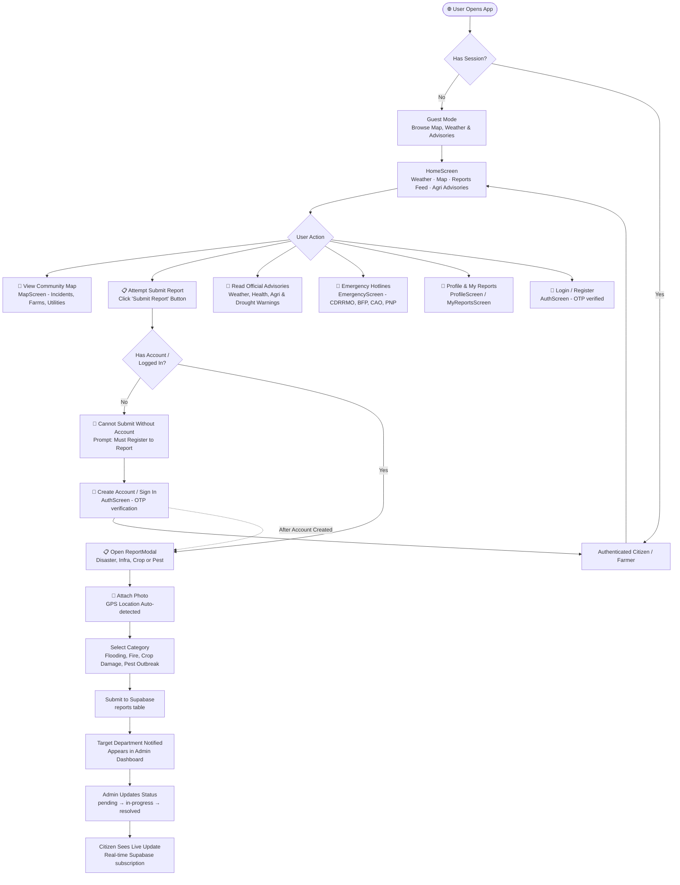

### 2B. Agency Admin Flow

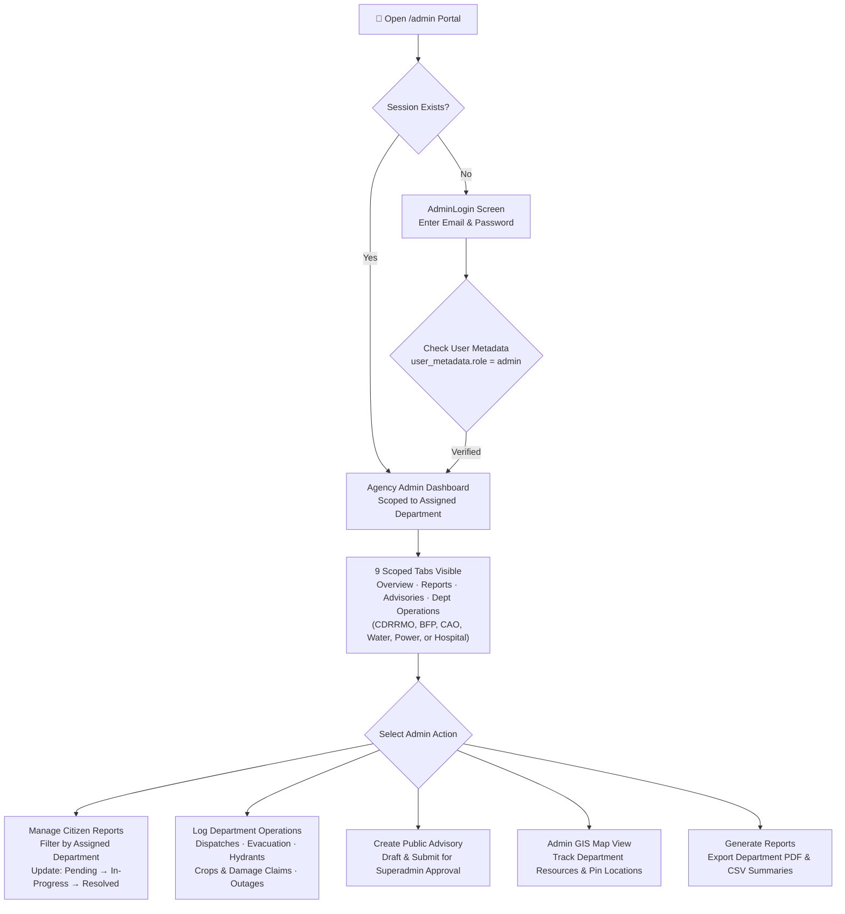

### 2C. Superadmin Flow

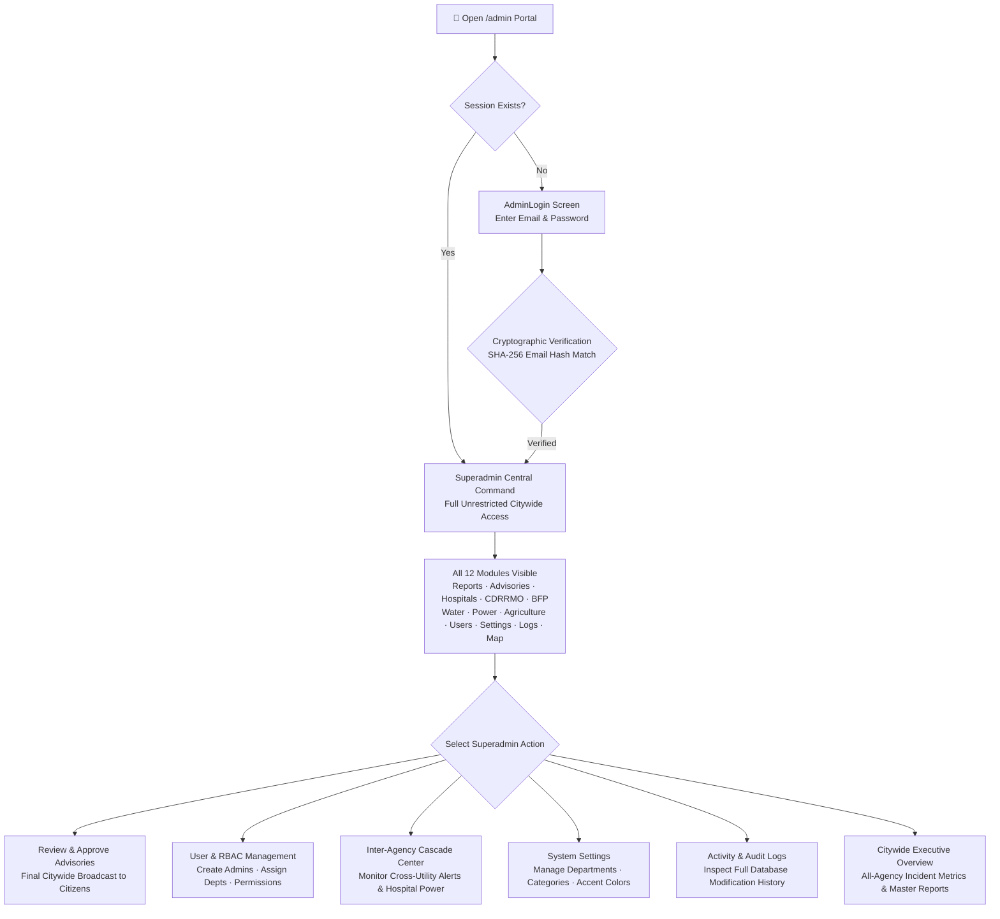

---

## 3. Data Flow — Global Architecture

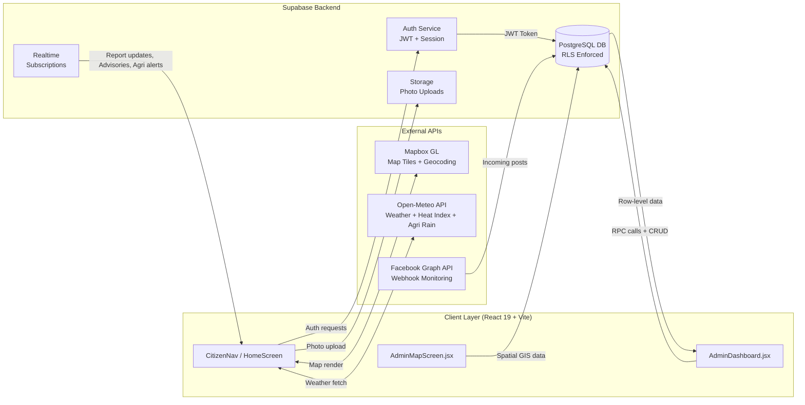

### Core Database Tables

| Table | Purpose | Key Fields |
|-------|---------|------------|
| `reports` | Citizen incident & damage reports | `id, category, status, lat, lng, user_id, department_id, images` |
| `departments` | Government agencies / offices | `id, name, code, accent_color, icon` |
| `categories` | Report categories per department | `id, name, group_name, department_id` |
| `advisories` | Official public bulletins & alerts | `id, title, content, status, department_id, scheduled_at, published_at` |
| `hospital_daily_reports` | Hospital capacity & health metrics | `id, hospital_id, date, available_beds, heat_cases` |
| `cdrrmo_dispatches` | Emergency response dispatch logs | `id, incident_type, status, team_deployed, destination` |
| `cdrrmo_evacuation_centers` | Evacuation center capacities | `id, name, capacity, current_occupants, status` |
| `bfp_stations` | Fire stations and response units | `id, name, trucks_available, personnel, status` |
| `bfp_hydrants` | Fire hydrant spatial infrastructure | `id, location, status, pressure_psi, last_inspected` |
| `water_facilities` | Pumping stations & reservoirs | `id, name, type, status, capacity_m3` |
| `water_interruptions` | Water service outage tracking | `id, area, start_time, end_time, reason, advisory_id` |
| `power_feeders` | Electrical distribution lines | `id, name, status, barangays_served, load_capacity` |
| `power_interruptions` | Scheduled & emergency power outages | `id, feeder_id, start_time, estimated_restoration, reason` |
| `agri_crop_monitoring` | Crop health, plantings & harvest data | `id, barangay, crop_type, area_hectares, stage, expected_yield` |
| `agri_damage_reports` | Calamity agricultural loss assessments | `id, report_id, farmer_name, crop_type, damage_hectares, estimated_loss, status` |
| `agri_facilities` | Solar dryers, warehouses & irrigation | `id, name, facility_type, barangay, capacity, operational_status` |
| `audit_logs` | Immutable audit trail of DB actions | `id, table_name, action, old_data, new_data, actor_id, created_at` |
| `notifications` | System & citizen notifications | `id, user_id, title, message, type, is_read` |
| `conflict_alerts` | Inter-agency cascade & conflict flags | `id, alert_type, severity, affected_agencies, status` |
| `inter_agency_notifications` | Cross-department operational memos | `id, from_dept, to_dept, subject, priority, message` |

---

## 4. Per-Module Analysis

---

### 4.1 Client Page (Citizen-Facing App)

**Entry Point:** `/` → `HomeScreen.jsx`  
**Navigation:** `CitizenNav.jsx` — bottom floating mobile tab bar

#### Screens Available

| Screen | Component | Access | Purpose |
|--------|-----------|--------|---------|
| Home / Dashboard | `HomeScreen.jsx` | Public | Live weather, advisories, quick report launcher, incident feed |
| Community Map | `MapScreen.jsx` | Public | Interactive Mapbox with 12 toggleable GIS layers (Incidents, Hospitals, Evacuation, Hydrants, Farms/Dryers, Utilities) |
| Emergency Hotlines | `EmergencyScreen.jsx` | Public | One-touch calling for CDRRMO, BFP, CAO, Hospitals, Police |
| My Reports | `MyReportsScreen.jsx` | Authenticated | Track submitted reports, review field updates and photos |
| Profile | `ProfileScreen.jsx` | Authenticated | Manage citizen info, barangay address, contact number |
| Login / Register | `AuthScreen.jsx` | Guests only | Phone/Email OTP authentication and password recovery |

#### Module Navigation (Bottom Tab Bar)

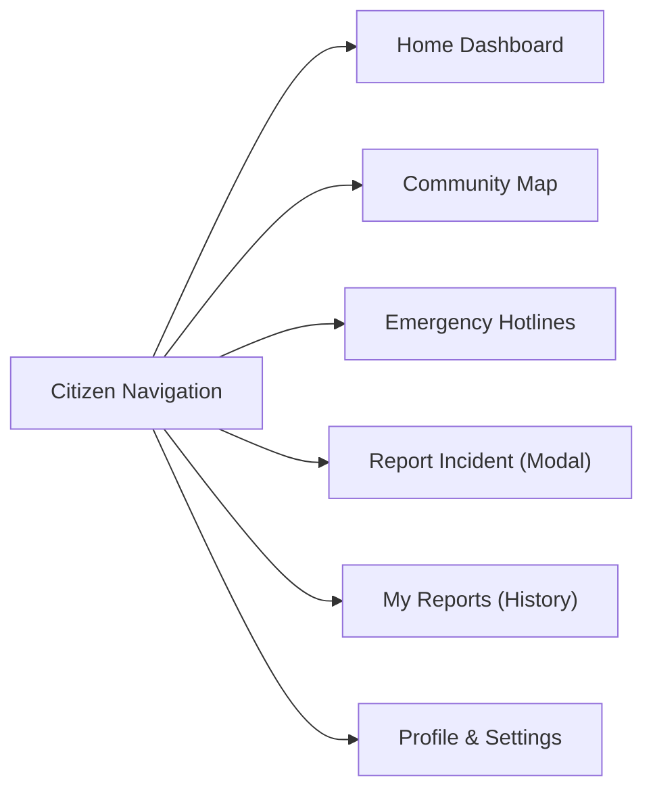

#### User Access Levels (Guest vs. Authenticated Citizen)

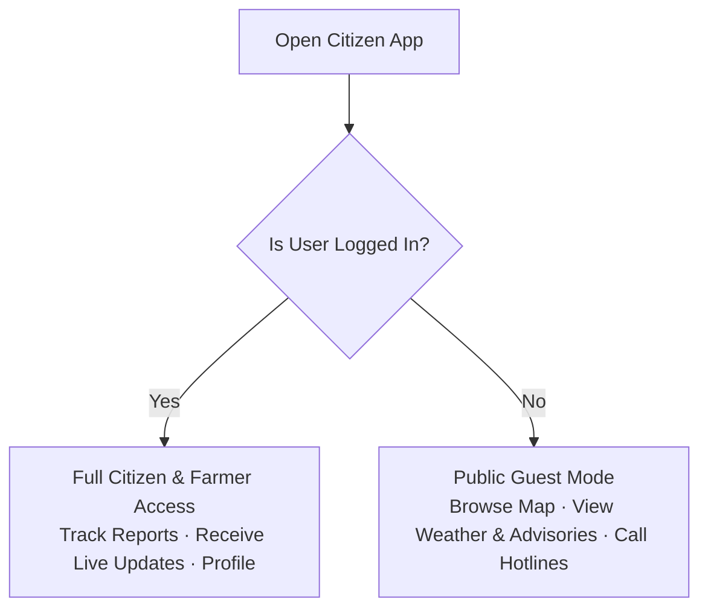

#### Simple Incident Reporting Flow

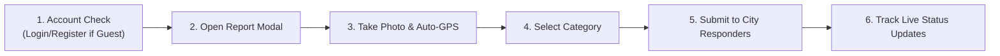

#### Citizen Features
- 🌤️ **Live Weather & Heat Index** — Real-time Open-Meteo data with heat danger flags and agricultural rain forecast.
- 🗺️ **Comprehensive GIS Map** — Layered spatial visualization of incidents, fire hydrants, evacuation centers, agricultural facilities, and utility outages.
- 🌾 **Agricultural & Weather Alerts** — Instant awareness of heavy downpours, drought advisories, pest outbreaks, and typhoon signals.
- 📋 **Multipurpose Incident Reporting** — Citizen reporting for general emergencies, power/water outages, road blockages, and agricultural calamity damages.
- 🚨 **Emergency Directory** — Fast click-to-call dialing to local CDRRMO, BFP, City Agri, and hospitals.

---

### 4.2 Admin Dashboard

**Entry Point:** `/admin` → `AdminDashboard.jsx`  
**Auth Gate:** `AdminLogin.jsx` → SHA-256 email hash check (Superadmin) + `user_metadata.role` (Agency Admin)

#### Module Navigation — Agency Admin Dashboard (9 Scoped Tabs)

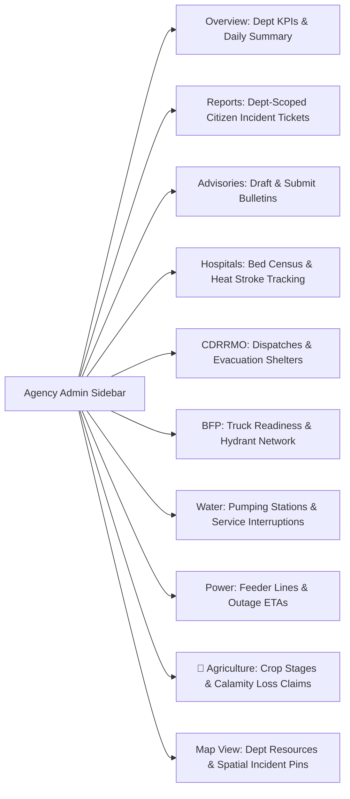

#### Module Navigation — Superadmin Dashboard (All 12 Modules)

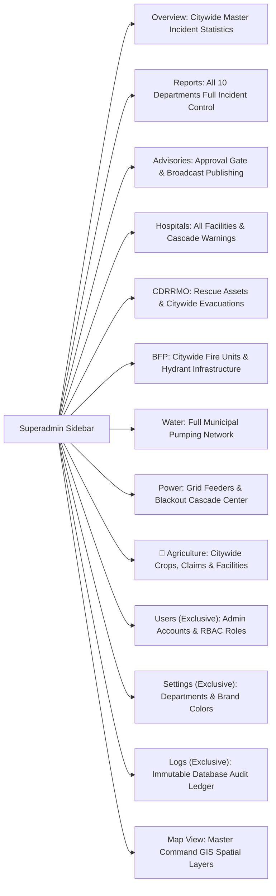

#### Role-Based Access Control — Agency Admin

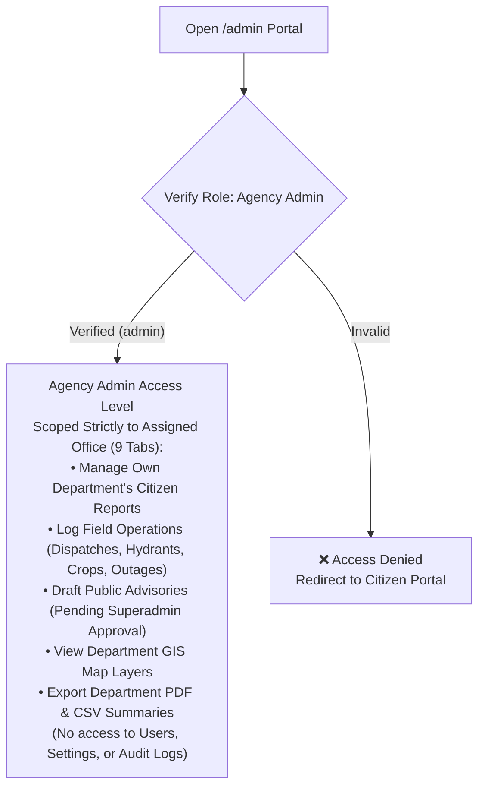

#### Role-Based Access Control — Superadmin

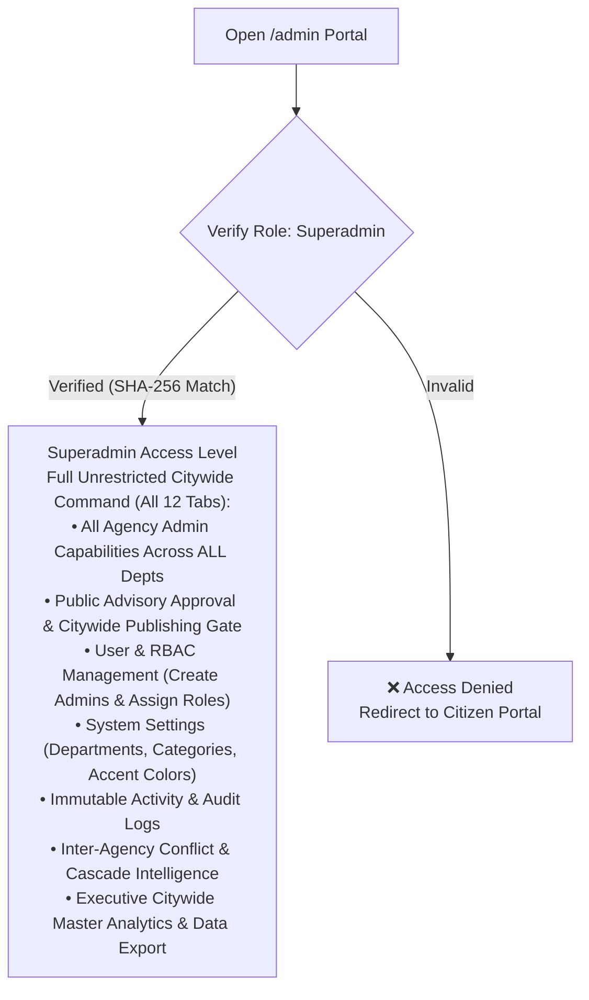

#### Data Flow — Admin Dashboard

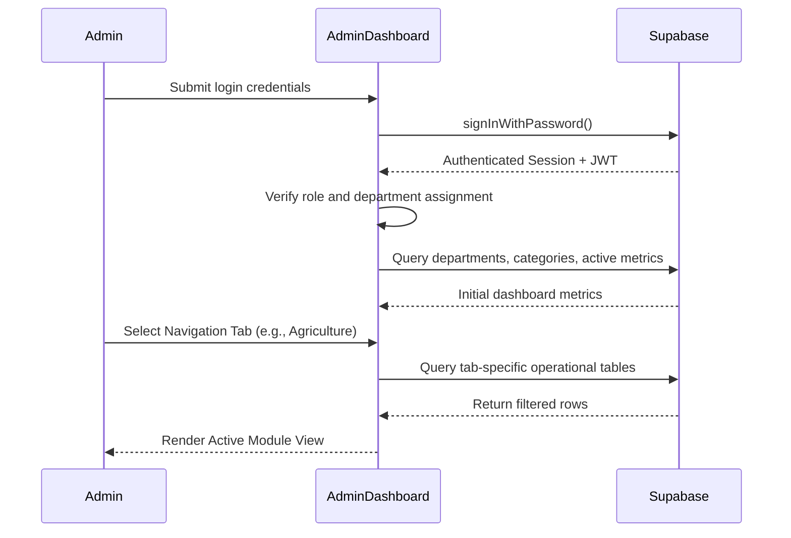

---

### 4.3 Reports Module

#### Incident Reporting & Resolution Process

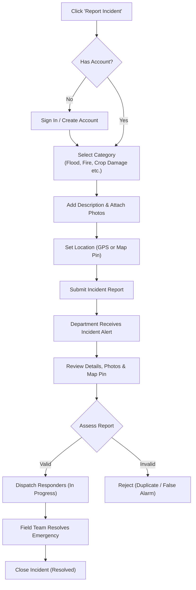

#### Process Overview (Presentation Summary)

1. **Citizen Submission:**
   - **Access:** Citizen logs in and taps "Report Incident".
   - **Details:** Selects category (e.g., flooding, fire, crop loss), writes description, and attaches photos.
   - **Location:** Auto-detects GPS coordinates or places an exact pin on the map.
   - **Submit:** Sends report directly to the city emergency command center.

2. **Department Response & Dispatch:**
   - **Alert:** The designated city agency (CDRRMO, BFP, City Agri, etc.) receives the ticket instantly.
   - **Verification:** Responders review photo proof and spatial map location.
   - **Dispatch:** Status changes to **In Progress** as field personnel are deployed.

3. **Resolution & Live Tracking:**
   - **On-Site Action:** Responders address the situation on the ground.
   - **Closure:** Once confirmed resolved, the ticket is marked **Resolved**.
   - **Live Citizen Update:** The reporting citizen sees real-time status and resolution notes directly in their app.

---

### 4.4 Advisory Module

#### Advisory Creation & Approval Process

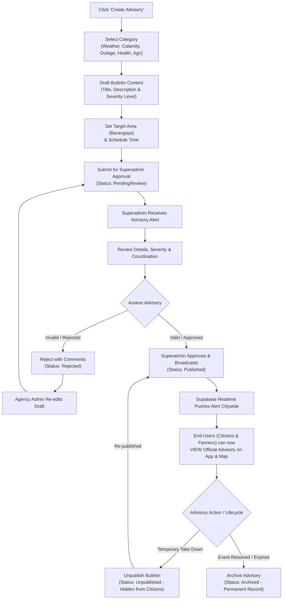

#### Process Overview (Presentation Summary)

1. **Agency Admin Drafting:**
   - **Creation:** Designated department admin (CDRRMO, BFP, CAO, Water, Power, Health) drafts an official public bulletin.
   - **Targeting & Scheduling:** Specifies advisory type (calamity, crop pest alert, water/power outage, health advisory), severity level, and optional scheduled broadcast time (`scheduled_at`).
   - **Submission:** Submits bulletin to the city command queue, moving state to **Pending Review**.

2. **Superadmin Review & Approval Gate:**
   - **Central Quality Control:** Superadmin evaluates bulletin accuracy, tone, and inter-agency coordination before public release.
   - **Approval & Broadcast:** Upon approval, the advisory is published citywide and timestamped (`published_at`).
   - **Rejection Loop:** If amendments are required, the advisory is rejected with explanatory notes and returned to **Draft** for revision and resubmission.

3. **Live Citizen Broadcast:**
   - **Instant Push Notification:** Supabase Realtime broadcasts the advisory immediately across all citizen devices.
   - **Multi-Screen Visibility:** Highlighted as top-level danger banners and cards on citizen `HomeScreen`, map overlays, and SMS/push feeds.
   - **Takedown Flexibility:** Admins can temporarily transition bulletins to **Unpublished** for rapid corrections, and toggle back to **Published** instantly.

4. **Resolution & Archival:**
   - **Closure:** Once the calamity resolves or the scheduled validity lapses, the bulletin transitions to **Archived**.
   - **Historical Audit:** Archived advisories are permanently stored for incident post-mortems and compliance reporting.

---

### 4.5 Hospital Module

#### Hospital Daily Census & Health Impact Flow

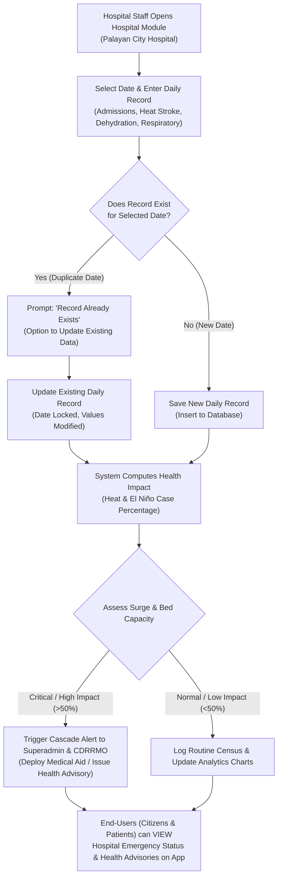

#### Process Overview (Presentation Summary)

1. **Daily Intake & Data Entry:**
   - **Access:** Hospital Staff / CHO Admin logs into the admin portal and navigates to the Hospital Module.
   - **Data Capture:** Enters daily total admissions alongside extreme weather health metrics (Heat Stroke, Heat Exhaustion, Dehydration, and Respiratory distress).
   - **Date Validation:** System blocks future dates to ensure genuine chronological reporting.

2. **Smart Duplicate Date Prevention:**
   - **Verification:** Automatically checks if a daily log already exists for the selected date.
   - **Friendly Update Flow:** If a duplicate is detected, rather than throwing an error, prompts the user with an *"Update Record"* option with date locking to protect historical logs.

3. **Automated Impact Analysis & Surge Triggers:**
   - **Impact Calculation:** Computes the percentage of admissions caused by environmental and heat factors.
   - **Inter-Agency Cascade:** When heat-related admissions spike or bed occupancy crosses critical thresholds, automatic surge alerts are sent to the City Disaster Office (CDRRMO) and Superadmin for medical emergency dispatch or drafting public health advisories.

4. **Public & Administrative Visibility:**
   - **Administrative Dashboard:** Recharts render 30-day historical admission trends and El Niño impact levels.
   - **Citizen View:** The general public and patients can view active hospital operational status and live health advisories on the citizen app.

---

### 4.6 CDRRMO Module

#### CDRRMO Disaster Operations & Ambulance Rescue Flow

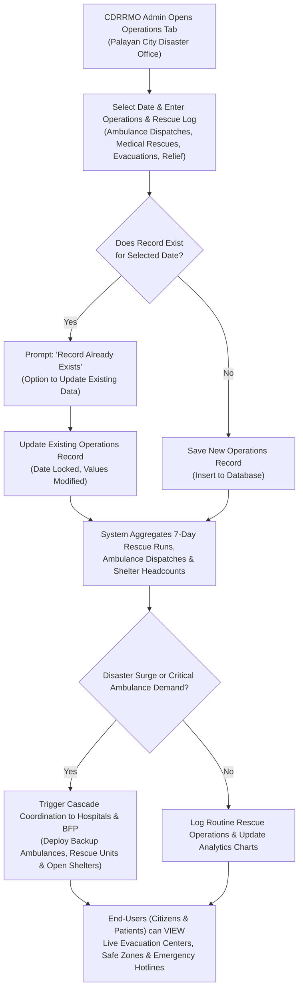

#### Process Overview (Presentation Summary)

1. **Operational Intake & Rescue Logging:**
   - **Access:** CDRRMO Officer logs into the admin portal and accesses the Operations Tab.
   - **Data Capture:** Enters daily emergency operations, specifically **Ambulance Dispatches, Field Medical Rescues**, relief goods distribution, family assistance, and evacuation shelter headcounts.
   - **Date Validation:** Blocks future date entries to maintain an accurate chronological rescue record.

2. **Smart Duplicate Date Handling:**
   - **Integrity Verification:** System checks if a daily operations log has already been submitted for the chosen date.
   - **Non-Destructive Update:** If duplicate exists, displays a clear modal allowing staff to update the day's record with date-locking enabled to protect chronological archives.

3. **Multi-Agency Escalation & Hospital Linkage:**
   - **Emergency Medical Synergy:** CDRRMO ambulance dispatches link directly with the City Health Office / Palayan City Hospital for coordinated emergency room triage.
   - **Cascade Mobilization:** If ambulance calls spike or a massive disaster occurs, alerts trigger automatically to Superadmin and BFP for joint emergency rescue teams and shelter opening.

4. **Public Evacuation & Emergency Accessibility:**
   - **Administrative Dashboard:** Displays 7-day rolling totals for ambulance runs, rescue dispatches, and relief goods.
   - **Citizen View:** Citizens and affected families can view real-time open evacuation centers, safe routes, and one-touch CDRRMO ambulance hotlines directly on the app.

---

### 4.7 BFP Module

#### BFP Fire Operations & Water Readiness Flow

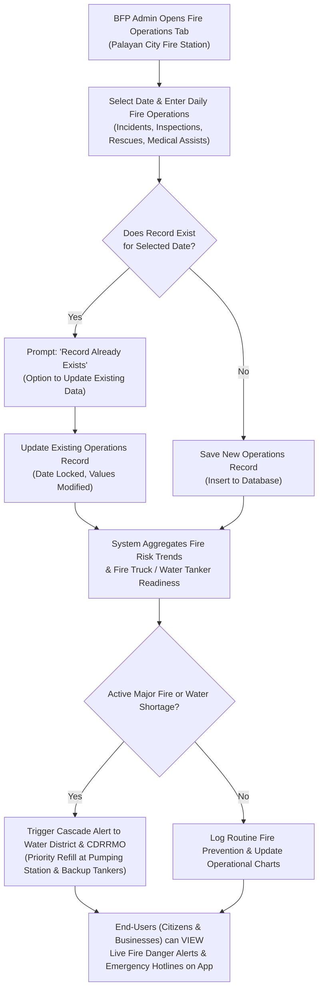

#### Process Overview (Presentation Summary)

1. **Daily Operational Intake & Logging:**
   - **Access:** BFP Officer logs into the admin portal and accesses the BFP Operations Tab.
   - **Data Capture:** Enters daily fire incidents responded to, building safety inspections, barangay safety seminars, rescues, and medical assists.
   - **Date Validation:** System prevents future date submissions to guarantee authentic reporting.

2. **Smart Duplicate Date Handling:**
   - **Integrity Check:** Checks if a daily log already exists for the chosen date.
   - **Safe Update Flow:** If a record exists, prompts staff with a friendly modal allowing them to update the day's record with date-locking enabled to preserve historical data.

3. **Inter-Agency Cascade & Water District Linkage:**
   - **Water Refill Telemetry:** Because the city operates without a municipal hydrant network, fire suppression relies on mobile fire trucks and water tankers.
   - **Cascade Response:** When major fire alarms strike or tanker water depletes, automated cascade alerts dispatch to the Water District (for emergency priority refilling at city pumping stations) and CDRRMO for coordinated response.

4. **Public Fire Safety & Emergency Visibility:**
   - **Administrative Dashboard:** Recharts track incident trends, seasonal fire risks (especially during El Niño / dry months), and truck readiness.
   - **Citizen View:** Residents can view active fire hazard warnings, safety guidelines, and one-touch BFP emergency hotlines on the citizen app.

---

### 4.8 Water Module

#### Water Utility Operations & Facility Status Flow

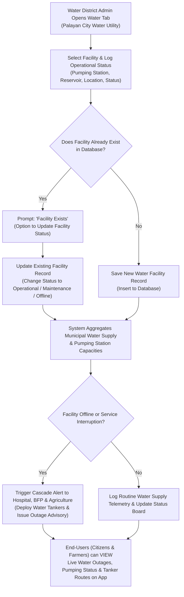

#### Process Overview (Presentation Summary)

1. **Facility Telemetry & Status Logging:**
   - **Access:** Water District Officer logs into the admin portal and accesses the Water Utility Tab.
   - **Data Capture:** Monitors city water infrastructure including pumping stations, reservoirs, and water treatment plants, logging operational state (*Operational, Maintenance, or Offline*).
   - **Location Mapping:** Each facility is mapped to its serving barangays to track municipal water pressure.

2. **Smart Facility Management & Updates:**
   - **Registry Check:** Checks whether the infrastructure asset is already registered in the municipal database.
   - **Status Toggle:** Admins can quickly update status when routine maintenance or unexpected pump breakdowns occur, keeping records synchronized without duplicate entries.

3. **Multi-Agency Cascade & Drought Linkage:**
   - **Inter-Agency Cascade:** When a primary pumping station trips offline or schedules maintenance, automated cascade warnings trigger to:
     - **City Hospital:** To verify reservoir backup levels.
     - **BFP Fire Station:** To divert fire trucks for water refilling to alternate stations.
     - **City Agriculture Office:** To assess impact on irrigation canals and farm drying.
   - **Emergency Deployment:** Dispatches emergency water tankers to affected residential barangays.

4. **Public Interruption Awareness:**
   - **Administrative Dashboard:** Displays live counts of operational vs offline facilities across the city grid.
   - **Citizen View:** Households and farmers can view scheduled water interruptions, live service recovery ETAs, and emergency tanker schedules on the citizen app.

---

### 4.9 Power Module

**Component:** `PowerUtilityTab` inside `AdminDashboard.jsx`  
**Tables:** `power_feeders`, `power_interruptions`, `power_restorations`

#### Key Features
- Distribution feeder monitoring with mapped barangay coverage.
- Outage logging (Emergency trip vs Scheduled maintenance) with restoration ETAs.
- Cross-agency cascade alerts: Automatic warnings to hospitals, water pumps, and cold storage facilities upon feeder loss.

---

### 4.10 Agriculture Module (City Agriculture Office - CAO)

**Component:** `AgricultureTab` inside `AdminDashboard.jsx`  
**Tables:** `agri_crop_monitoring`, `agri_damage_reports`, `agri_facilities`, `agri_supplies`  
**Citizen View:** `HomeScreen.jsx` (Agri Advisories) & `ReportModal.jsx` (Crop/Farm Damage Reporting)

#### Data Flow — Agriculture Module

```mermaid
flowchart TD
    subgraph CITIZEN["Farmers and Citizens"]
        F1["Farmer submits crop damage or pest report"] --> R[("reports table")]
        F2["Farmer views drought and weather advisories"] <-- RT[("Supabase Realtime")]
    end

    subgraph CAO["City Agriculture Office Admin"]
        CAO_ADM["Agriculture Officer"] --> TAB["AgricultureTab"]
        TAB --> M1["Crop Monitoring<br/>Hectares, Stage, Expected Yield"]
        TAB --> M2["Damage Assessment Validation<br/>Verify claims and compute losses"]
        TAB --> M3["Agricultural Facilities<br/>Solar dryers, Cold storage, Irrigation"]
        TAB --> M4["Farm Supply Inventory<br/>Seeds, Fertilizers, Fuel subsidies"]
    end

    subgraph CROSS["Inter-Agency Intelligence"]
        WX["Open-Meteo<br/>Heat Index and Rain Forecast"] --> TAB
        PWR["Power Outage on Cold Storage"] --> ALERT["Conflict Alert"]
        WAT["Irrigation canal dry or pump offline"] --> TAB
    end

    R --> TAB
    TAB --> VAL["Validated Calamity Loss Report"]
    VAL --> EXP["Export for DA and City Council Aid"]
    M2 --> ADV[("advisories table")]
    ADV --> RT
```

#### Key Features

1. **Crop Health & Seasonal Planting Monitoring:**
   - Tracks standing crops (Rice, Corn, High-Value Crops, Vegetables) by barangay.
   - Monitors crop growth stages (Seedling, Vegetative, Reproductive, Harvesting).
   - Estimates expected harvest yield and market readiness.

2. **Calamity Damage Assessment & Validation:**
   - Intake and validation of farmer damage reports post-typhoon, flood, drought, or extreme heat.
   - Computes damaged area (hectares) and estimated monetary loss (PHP).
   - Generates official City Agriculture Loss Reports for Department of Agriculture (DA) quick response funding and crop insurance claims.

3. **Agricultural Facilities & Machinery Tracking:**
   - Spatial monitoring of public solar dryer pavements, cold storage units, rice mills, and irrigation water gates.
   - Status tracking (Operational, Under Repair, Flooded, Unavailable).

4. **Pest & Livestock Disease Outbreak Early Warning:**
   - Tracking of Fall Armyworm (FAW), Rice Tungro, African Swine Fever (ASF), and avian influenza reports.
   - Automated triggers for containment advisories to affected barangays.

5. **Inter-Agency Synergies:**
   - **Weather + Agriculture:** High heat index automatically alerts CAO to drought stress on standing rice crops.
   - **Water + Agriculture:** Pumping station outages cross-referenced with farm irrigation supply lines.
   - **Power + Agriculture:** Electrical blackouts trigger alerts for municipal cold storage and dairy preservation facilities.

---

### 4.11 User Permission Module

**Component:** `UsersTab` inside `AdminDashboard.jsx` (Superadmin only)  
**Tables:** `auth.users` (accessed via `get_auth_users()` `SECURITY DEFINER` RPC)

#### Data Flow — User Permissions

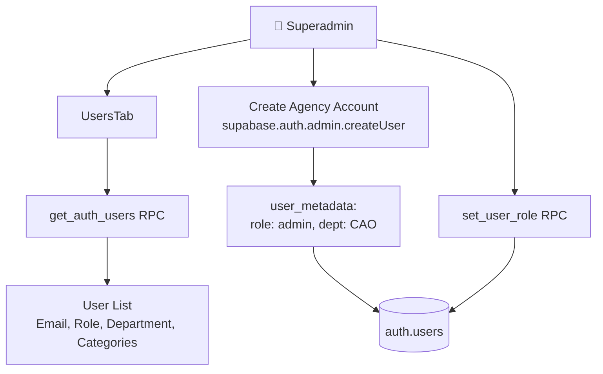

#### Role Levels

| Role | Target Users | Admin Console Access | Data Scope |
|------|--------------|----------------------|------------|
| `citizen` | General Public, Farmers, Residents | None (Citizen App only) | Own submitted reports and public views |
| `admin` | Department Personnel (CDRRMO, BFP, CAO, Water, Power, Hospitals) | Yes (9 scoped tabs) | Scoped strictly to assigned department data & reports |
| `superadmin` | City Administrator, City ICT Office | Yes (All 12 tabs) | Full system-wide read/write, user management, audit logs |

---

### 4.12 Settings Module

**Component:** `SettingsTab` inside `AdminDashboard.jsx` (Superadmin only)  
**Tables:** `departments`, `categories`

#### Key Features
- **Department CRUD:** Create, update, or disable city departments with dedicated brand colors and icons.
- **Category Management:** Define incident reporting categories (e.g., Flooding, Fire, Crop Damage, Water Leak) and assign them to responsible departments.
- **Dynamic Theming:** Agency admin dashboards inherit their department's accent color automatically.

---

### 4.13 Logs Module

**Component:** `ActivityLogsTab` inside `AdminDashboard.jsx` (Superadmin only)  
**Tables:** `audit_logs`, `security_events`

#### Key Features
- Immutable ledger capturing every DB `INSERT`, `UPDATE`, and `DELETE` via PostgreSQL trigger functions.
- Captured metadata: Table name, operation, previous JSON state, new JSON state, acting user ID, and timestamp.
- Comprehensive security audit log capturing failed logins, role modifications, and privilege escalations.

---

## 5. Use Case Diagrams

### 5.1 End-User (Citizen & Farmer) Use Cases

```mermaid
graph TD
    EU(["👤 Citizen & Farmer"])

    EU --> UC1["View Weather & Heat Index<br/>Hourly & 7-Day Forecast"]
    EU --> UC2["Browse Community GIS Map<br/>Incidents · Facilities · Outages"]
    EU --> UC3["View Official Advisories<br/>Weather · Health · Agri Warnings"]
    EU --> UC4["Access Emergency Hotlines<br/>CDRRMO · BFP · CAO · Hospitals · Police"]
    EU --> UC5["Submit Incident Report<br/>General Disaster · Infra · Utility Outage"]
    EU --> UC6["Submit Agricultural Damage Report<br/>Crop Loss · Pest Outbreak · Irrigation"]
    EU --> UC7["Register / Login<br/>OTP verified mobile or email"]
    EU --> UC8["Track My Reports<br/>Live status updates & resolution notes"]
    EU --> UC9["Manage Profile<br/>Contact details & barangay location"]
    EU --> UC10["Guest Browsing<br/>Read-only access without login"]

    UC5 --> AUTH{"User Session"}
    UC6 --> AUTH
    AUTH -- "Guest (No Account)" --> GUEST["Blocked: Must register / log in first"]
    AUTH -- "Authenticated" --> ACCT["Tied to account & tracked in history"]

    style EU fill:#2d8119,color:#fff
```

### 5.2 Admin (Agency Admin) Use Cases

```mermaid
graph TD
    ADMIN(["🔐 Agency Admin<br/>e.g., CAO / CDRRMO / BFP"])

    ADMIN --> A1["Login to Admin Console<br/>/admin portal"]
    ADMIN --> A2["View Department Overview<br/>Key department KPIs & alerts"]
    ADMIN --> A3["Manage Citizen Reports<br/>Acknowledge · Dispatch · Resolve"]
    ADMIN --> A4["Create Department Advisories<br/>Draft & submit for Superadmin approval"]
    ADMIN --> A5["Manage Operations<br/>CDRRMO / BFP / Hospital / Agri"]
    ADMIN --> A6["Track Utilities<br/>Water pumping & Power feeders"]
    ADMIN --> A7["Monitor Agricultural Operations<br/>Crop records · Calamity claims · Facilities"]
    ADMIN --> A8["Export Analytics<br/>Generate official PDF & CSV reports"]
    ADMIN --> A9["View Spatial GIS Map<br/>Track department resources & incidents"]
    ADMIN --> A10["Receive Inter-Agency Alerts<br/>Cross-utility cascade warnings"]

    style ADMIN fill:#2563eb,color:#fff
```

### 5.3 Superadmin Use Cases

```mermaid
graph TD
    SA(["👑 Superadmin<br/>City Administrator / ICT"])

    SA --> S1["All Agency Admin Capabilities +"]
    SA --> S2["Approve / Reject Public Advisories<br/>Final citywide publishing gate"]
    SA --> S3["Manage User Accounts & RBAC<br/>Create admins · Assign departments · Roles"]
    SA --> S4["Configure Departments & Categories<br/>CRUD departments · Category bindings"]
    SA --> S5["View Immutable Audit Logs<br/>Full database modification trail"]
    SA --> S6["Inter-Agency Conflict Center<br/>Monitor cross-utility cascades"]
    SA --> S7["Executive City Dashboard<br/>Cross-agency citywide metrics"]
    SA --> S8["Resolve System Alerts<br/>Acknowledge & clear system emergencies"]
    SA --> S9["System Configuration & Maintenance<br/>Backup · Security · Platform variables"]

    style SA fill:#dc2626,color:#fff
```

---

## 6. Role Comparison Matrix

| Feature / Module | 👤 Citizen / Farmer | 🔐 Agency Admin | 👑 Superadmin |
|------------------|:-------------------:|:---------------:|:-------------:|
| View Weather & Community Map | ✅ | ✅ | ✅ |
| Submit General Incident Report | ✅ | ✅ | ✅ |
| Submit Farm Damage / Pest Report | ✅ | ✅ | ✅ |
| View Published Advisories | ✅ | ✅ | ✅ |
| Access Emergency Hotlines | ✅ | ✅ | ✅ |
| Admin Console Access (`/admin`) | ❌ | ✅ | ✅ |
| Manage Reports (Status / Notes) | ❌ | ✅ *(Dept-scoped)* | ✅ *(All)* |
| Draft Public Advisories | ❌ | ✅ *(Dept-scoped)* | ✅ |
| **Approve & Publish Advisories** | ❌ | ❌ | ✅ |
| Hospital Capacity Module | ❌ | ✅ | ✅ |
| CDRRMO Operations Module | ❌ | ✅ | ✅ |
| BFP Fire Operations Module | ❌ | ✅ | ✅ |
| Water Utility Module | ❌ | ✅ | ✅ |
| Power Utility Module | ❌ | ✅ | ✅ |
| **Agriculture Module (CAO)** | ❌ *(Can report)* | ✅ | ✅ |
| **User & RBAC Management** | ❌ | ❌ | ✅ |
| **Settings (Depts & Categories)** | ❌ | ❌ | ✅ |
| **Audit & Activity Logs** | ❌ | ❌ | ✅ |
| Inter-Agency Cascade Center | ❌ | Read-Only | ✅ Full |
| Spatial GIS Map Admin Control | ❌ | ✅ | ✅ |
| Export Official PDF / CSV Reports | ❌ | ✅ | ✅ |
| Executive Citywide Analytics | ❌ | ❌ | ✅ |

---

## 7. Security Model

```mermaid
flowchart TD
    REQ["Client API Request"] --> JWT{"Valid Supabase JWT?"}
    JWT -- "No" --> PUB["Public RLS Policies<br/>Read-only on published reports & advisories"]
    JWT -- "Yes" --> ROLE{"user_metadata.role"}

    ROLE -- "citizen" --> CIT["Citizen Policies<br/>CRUD on own reports<br/>Read-only on public data"]
    ROLE -- "admin" --> ADM["Agency Admin Policies<br/>Scoped by assigned_department<br/>Audit-logged updates"]
    ROLE -- "superadmin" --> SAP["Superadmin Policies<br/>Bypass dept restrictions<br/>Full platform access"]

    ADM --> RLS["Row Level Security Enforcement<br/>auth.uid + auth.jwt"]
    SAP --> RLS
    RLS --> DB[("PostgreSQL Database")]
    DB --> AUD["PostgreSQL Trigger: process_audit_log"]
    AUD --> LOG[("audit_logs Table")]
```

### Security Safeguards

| Layer | Safeguard | Implementation Details |
|-------|-----------|------------------------|
| **Authentication** | Supabase JWT | Secure token refresh, session persistence, OTP email/phone authentication. |
| **Superadmin Gate** | SHA-256 Email Hash | Superadmin identity verified via client & server SHA-256 cryptographic hash checks. |
| **Access Control** | Row Level Security (RLS) | Strictly enforced on all PostgreSQL tables using `auth.uid()` and `user_metadata.role`. |
| **Data Integrity** | PostgreSQL Triggers | `process_audit_log()` captures pre- and post-mutation JSON state on every critical table. |
| **Privileged RPC** | `SECURITY DEFINER` Functions | Administrative operations (e.g., `get_auth_users()`, `set_user_role()`) run with elevated database privileges only when called by a verified superadmin. |
| **Input Protection** | Sanitization & Validation | Multi-tier input validation, XSS prevention, and parameterized queries across all endpoints. |

---

*Document generated from CLIMA / PalaSumbong System Architecture Analysis — October 2026*  
*Covers: Citizen Portal · Multi-Agency Admin Console · City Agriculture Office Integration · Database Architecture*
